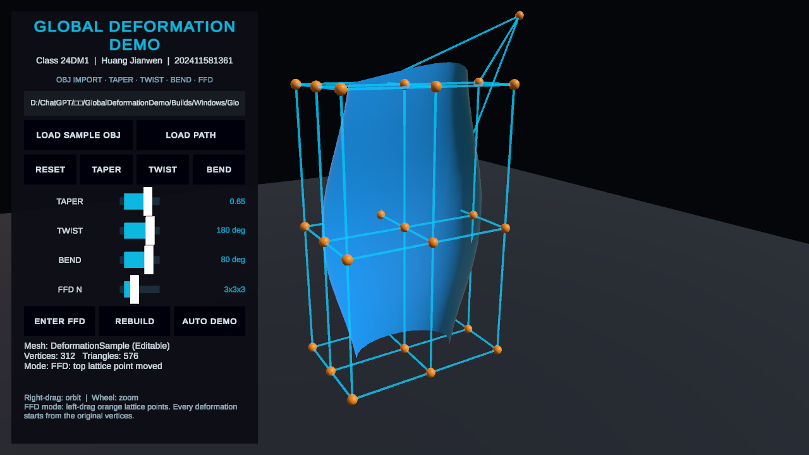

# Unity 全局网格变形演示程序

课程作业任务二：在 Unity 中导入 OBJ 网格，并通过按钮演示锥化、扭曲、弯曲和自由形式变形（FFD）。

- 班级：24数媒1
- 姓名：黄建文
- 学号：202411581361
- Unity：2022.3.62f3c1 LTS
- 目标平台：Windows x86-64

## 功能

- 运行时读取本地 OBJ 文件，支持 `v`、`vt`、`vn`、`f`、多边形扇形三角化和负索引。
- 附带一个具有 312 个顶点、576 个三角形的分段示例 OBJ。
- 通过按钮选择 `TAPER`、`TWIST`、`BEND` 或 `FFD`。
- 使用滑块实时调整锥化量、扭曲角度、弯曲角度和 FFD 网格阶数。
- 根据原始模型包围盒生成 `n×n×n` FFD 晶格，支持 `2≤n≤5`。
- FFD 模式下可以拖动任意橙色晶格点，模型顶点实时更新。
- 支持右键旋转观察、滚轮缩放和一键自动演示。
- 每次锥化、扭曲和弯曲都从原始顶点重新计算，避免误差累积。

## 运行方法

1. 使用 Unity Hub 打开本工程。
2. 打开 `Assets/Scenes/GlobalDeformationDemo.unity`。
3. 点击 Play。

也可以运行本机构建结果：

```text
Builds/Windows/GlobalDeformationDemo.exe
```

`Builds` 属于生成目录，默认不提交到 Git 仓库。

## 操作说明

| 操作 | 功能 |
|---|---|
| `LOAD SAMPLE OBJ` | 加载工程内置示例 OBJ |
| 路径框 + `LOAD PATH` | 从完整文件路径读取外部 OBJ |
| `RESET` | 恢复原始模型和规则晶格 |
| `TAPER` | 应用锥化，参数由 TAPER 滑块控制 |
| `TWIST` | 应用绕模型 Y 轴的扭曲 |
| `BEND` | 应用沿模型高度方向的弯曲 |
| `ENTER FFD` | 显示晶格并进入 FFD 编辑模式 |
| `REBUILD` | 按 FFD N 滑块重新生成规则晶格 |
| `AUTO DEMO` | 自动依次演示四类变形 |
| 鼠标右键拖动 | 旋转观察视角 |
| 鼠标滚轮 | 缩放视角 |
| FFD 模式左键拖动橙色点 | 修改晶格点并实时变形 |

## FFD 实现

模型导入后首先计算局部包围盒：

```text
Bounds = [xmin, xmax] × [ymin, ymax] × [zmin, zmax]
```

初始状态把包围盒三个方向分别等分，得到 `n×n×n` 个规则控制点。每个原始顶点被归一化为包围盒内的参数坐标 `(s,t,u)`，其中三个分量都在 `[0,1]` 内。

终止状态使用三元 Bernstein 基函数计算：

```text
P(s,t,u) = Σi Σj Σk Bi(s) Bj(t) Bk(u) Pijk
```

`Pijk` 是用户修改后的晶格点。规则晶格保持原模型不变；拖动晶格点后，受相应基函数权重影响的网格顶点平滑移动。

## 主要代码

```text
Assets/Scripts/RuntimeObjLoader.cs
Assets/Scripts/DeformationMath.cs
Assets/Scripts/MeshDeformer.cs
Assets/Scripts/FfdLatticeView.cs
Assets/Scripts/OrbitCamera.cs
Assets/Scripts/GlobalDeformationDemoApp.cs
Assets/Scripts/DeformationDemoRecorder.cs
Assets/Editor/GlobalDeformationProjectBuilder.cs
```

## 自动测试

EditMode 测试位于：

```text
Assets/Tests/EditMode/DeformationMathTests.cs
```

测试覆盖：

- 锥化零参数保持顶点不变；
- 扭曲零角度保持顶点不变；
- 弯曲零角度保持顶点不变；
- 规则 FFD 晶格严格复现原始顶点；
- 移动晶格角点后，匹配的包围盒角点正确移动；
- OBJ 四边形正确三角化。

当前测试结果：`6 passed, 0 failed`。XML 报告保存在 `TestResults/EditModeResults.xml`。

## 演示视频



[点击查看 14 秒演示视频](DemoVideo/GlobalDeformationDemo.mp4)

视频依次展示原始 OBJ、锥化、扭曲、弯曲和移动 FFD 晶格点后的效果。

## 仓库提交说明

仓库应直接提交未压缩的 Unity 工程文件，包括：

```text
Assets/
Packages/
ProjectSettings/
DemoVideo/
README.md
```

不要提交以下自动生成目录：

```text
Library/
Temp/
Logs/
Builds/
CaptureFrames/
```

在课程平台提交时，应直接填写 GitHub 仓库链接；不要把链接写入 TXT，也不要上传链接截图。
